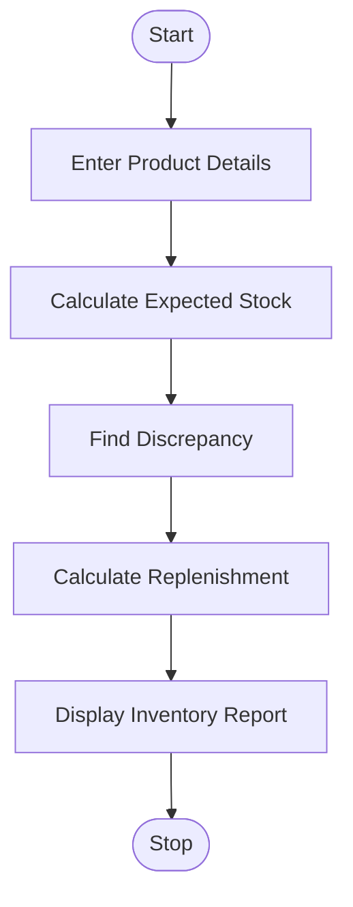

# 14. Warehouse Inventory Reconciliation

## 1. Problem Statement

Write a Python program to manage warehouse inventory across multiple products. The system compares opening stock, incoming stock, dispatched quantities, and actual closing stock. It identifies stock discrepancies and calculates replenishment requirements.

Formulas:

- Expected Stock = Opening Stock + Incoming Stock − Dispatched Stock
- Discrepancy = Actual Closing Stock − Expected Stock
- Replenishment = max(0, Minimum Stock − Actual Closing Stock)

## 2. Algorithm

1. Start the program.
2. Enter the number of products.
3. Read opening, incoming, dispatched, closing, and minimum stock.
4. Validate the entered quantities.
5. Calculate expected closing stock.
6. Compare expected and actual closing stock.
7. Identify stock shortages or excess stock.
8. Calculate replenishment requirements.
9. Display the inventory summary and stop.

## 3. Flowchart 

## 5. Sample Input

Enter number of products: 2

Product 1
Product name: Rice
Opening stock: 200
Incoming stock: 100
Dispatched stock: 180
Actual closing stock: 110
Minimum required stock: 150

Product 2
Product name: Sugar
Opening stock: 150
Incoming stock: 50
Dispatched stock: 100
Actual closing stock: 100
Minimum required stock: 120

## 6. Sample Output

--- Inventory Report ---
Product: Rice
Expected Stock: 120
Actual Stock: 110
Discrepancy: -10
Status: Stock Shortage
Replenishment Required: 40

--- Inventory Report ---
Product: Sugar
Expected Stock: 100
Actual Stock: 100
Discrepancy: 0
Status: Stock Matched
Replenishment Required: 20

--- Final Summary ---
Total Replenishment: 60
Total Absolute Discrepancy: 10
Inventory Reconciliation Completed

### Inventory Calculation

| Details          | Rice | Sugar |
| ---------------- | ---- | ----- |
| Opening Stock    | 200  | 150   |
| Incoming Stock   | 100  | 50    |
| Dispatched Stock | 180  | 100   |
| Expected Stock   | 120  | 100   |
| Actual Stock     | 110  | 100   |
| Discrepancy      | -10  | 0     |
| Replenishment    | 40   | 20    |

Explanation: Rice has a shortage of 10 units, while Sugar has no discrepancy. Both products require replenishment to maintain their minimum stock levels.

