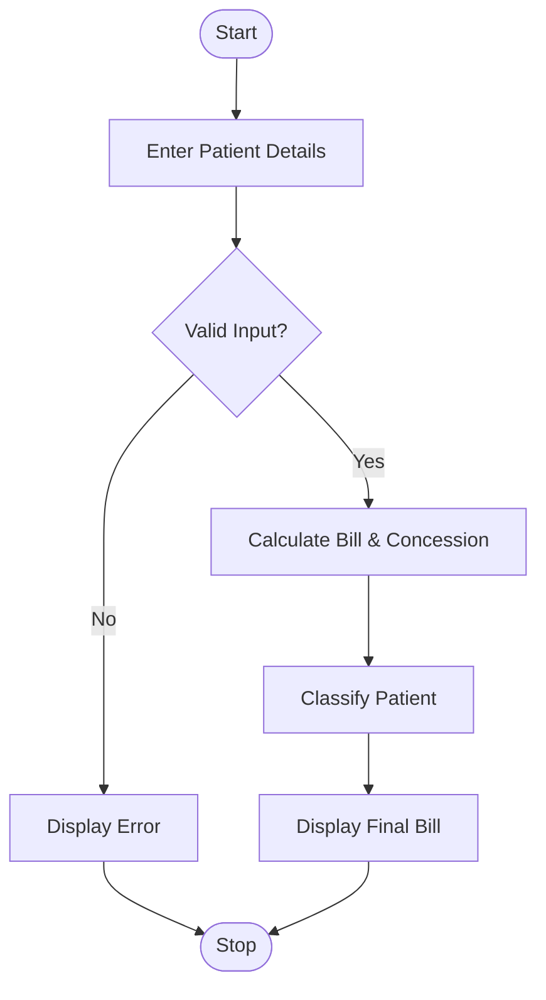

# 3. Hospital Billing and Patient Classification

## 1. Problem Statement

Write a Python program to calculate hospital bills using consultation, diagnostic, and treatment charges. Apply concessions based on patient category, validate billing amounts, and classify patients according to their final bill.

Assumed Payment Policy:

| Patient Category | Concession |
| ---------------- | ---------- |
| General          | 0%         |
| Senior Citizen   | 20%        |
| Low Income       | 30%        |

Patient Classification:

| Final Bill     | Classification |
| -------------- | -------------- |
| Below ₹2,000   | Low Bill       |
| ₹2,000–₹10,000 | Medium Bill    |
| Above ₹10,000  | High Bill      |

## 2. Algorithm

1. Start the program.
2. Enter patient name, category, and hospital charges.
3. Validate that all charges are non-negative.
4. Calculate the total hospital bill.
5. Apply concession based on patient category.
6. Calculate the final payable amount.
7. Classify the patient based on the final bill.
8. Display the bill and stop.

## 3. Flowchart

## 5. Sample Input
Enter patient name: Ravi

1.General  2.Senior Citizen  3.Low Income
Enter category (1-3): 2

Consultation charge: 1000
Diagnostic charge: 2000
Treatment charge: 5000

## 6. Sample Output

--- Hospital Bill ---

Patient: Ravi
Category: Senior Citizen
Total: Rs. 8000.0
Concession: Rs. 1600.0
Final Bill: Rs. 6400.0
Classification: Medium Bill

### Calculation

Total Bill = 1000 + 2000 + 5000 = ₹8,000

Concession = 8000 × 20% = ₹1,600

Final Bill = 8000 − 1600 = ₹6,400

Therefore, the patient is classified under the Medium Bill category.

