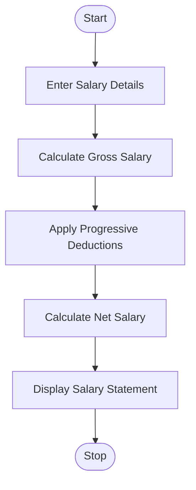

# 4. Employee Payroll and Deduction Analysis

## 1. Problem Statement

Write a Python program to calculate an employee's gross salary using basic pay, allowances, overtime, and incentives. Apply progressive deductions and generate a formatted salary statement showing gross salary, total deductions, and net salary.

Assumed Deduction Policy:

| Gross Salary Slab | Deduction Rate |
| ----------------- | -------------- |
| First ₹20,000     | 5%             |
| Next ₹30,000      | 10%            |
| Above ₹50,000     | 15%            |

Gross Salary = Basic Pay + Allowances + Overtime Pay + Incentives

Net Salary = Gross Salary − Total Deductions

## 2. Algorithm

1. Start the program.
2. Enter employee name and salary details.
3. Calculate overtime pay.
4. Calculate gross salary by adding all earnings.
5. Apply progressive deductions based on salary slabs.
6. Calculate net salary.
7. Display the formatted salary statement.
8. Stop.

## 3. Flowchart 

## 5. Sample Input

Employee Name: Ravi
Basic Pay: 40000
Allowances: 8000
Overtime Hours: 10
Overtime Rate: 200
Incentives: 5000

## 6. Sample Output

------ SALARY STATEMENT ------
Employee Name : Ravi
Basic Pay     : Rs.40000.00
Allowances    : Rs.8000.00
Overtime Pay  : Rs.2000.00
Incentives    : Rs.5000.00
------------------------------
Gross Salary  : Rs.55000.00
Deductions    : Rs.4750.00
Net Salary    : Rs.50250.00

### Calculation

Gross Salary:

40,000 + 8,000 + 2,000 + 5,000 = ₹55,000

Progressive Deductions:

| Salary Portion         | Deduction |
| ---------------------- | --------- |
| First ₹20,000 × 5%     | ₹1,000    |
| Next ₹30,000 × 10%     | ₹3,000    |
| Remaining ₹5,000 × 15% | ₹750      |
| Total Deduction        | ₹4,750    |

Net Salary = ₹55,000 − ₹4,750 = ₹50,250

