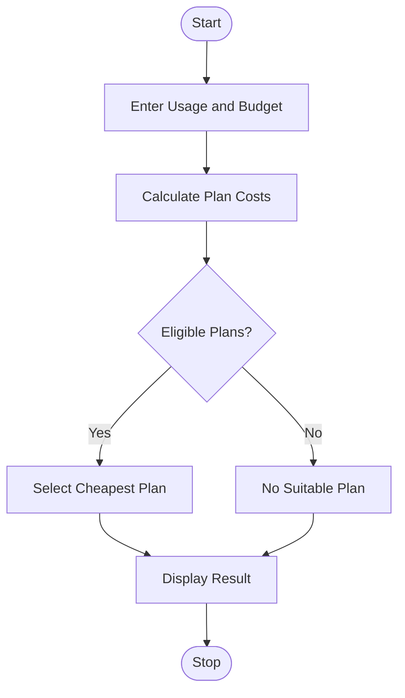

# 5. Multi-Plan Telecommunications Cost Optimization

## 1. Problem Statement

Write a Python program to compare multiple mobile plans based on data usage, validity, and budget. Calculate extra usage charges and identify the most economical eligible plan.

Assumed Mobile Plans:

| Plan     | Price | Data Limit | Validity | Extra Charge/GB |
| -------- | ----- | ---------- | -------- | --------------- |
| Basic    | ₹199  | 2 GB       | 28 days  | ₹50             |
| Standard | ₹399  | 5 GB       | 30 days  | ₹40             |
| Premium  | ₹599  | 10 GB      | 56 days  | ₹30             |

The best plan must satisfy the required validity and budget while having the lowest total cost.

## 2. Algorithm

1. Start the program.
2. Enter required data, validity, and budget.
3. Store the available mobile plans.
4. Calculate excess data usage for each plan.
5. Add excess charges to the base price.
6. Check validity and budget constraints.
7. Select the eligible plan with the lowest total cost.
8. Display the best plan and stop.

## 3. Flowchart 

## 5. Sample Input

Required Data (GB): 6
Required Validity (days): 30
Enter Budget: 700

## 6. Sample Output

--- Plan Comparison ---

Plan: Basic
Extra Charge: Rs. 200.0
Total Cost: Rs. 399.0
Status: Not Eligible

Plan: Standard
Extra Charge: Rs. 40.0
Total Cost: Rs. 439.0
Status: Eligible

Plan: Premium
Extra Charge: Rs. 0.0
Total Cost: Rs. 599.0
Status: Eligible

--- Best Plan ---
Recommended Plan: Standard
Minimum Cost: Rs. 439.0

### Calculation

| Plan     | Total Cost | Status                  |
| -------- | ---------- | ----------------------- |
| Basic    | ₹399       | Not Eligible (Validity) |
| Standard | ₹439       | Eligible                |
| Premium  | ₹599       | Eligible                |

Standard Plan is selected because it satisfies the required data, validity, and budget constraints at the lowest total cost.
