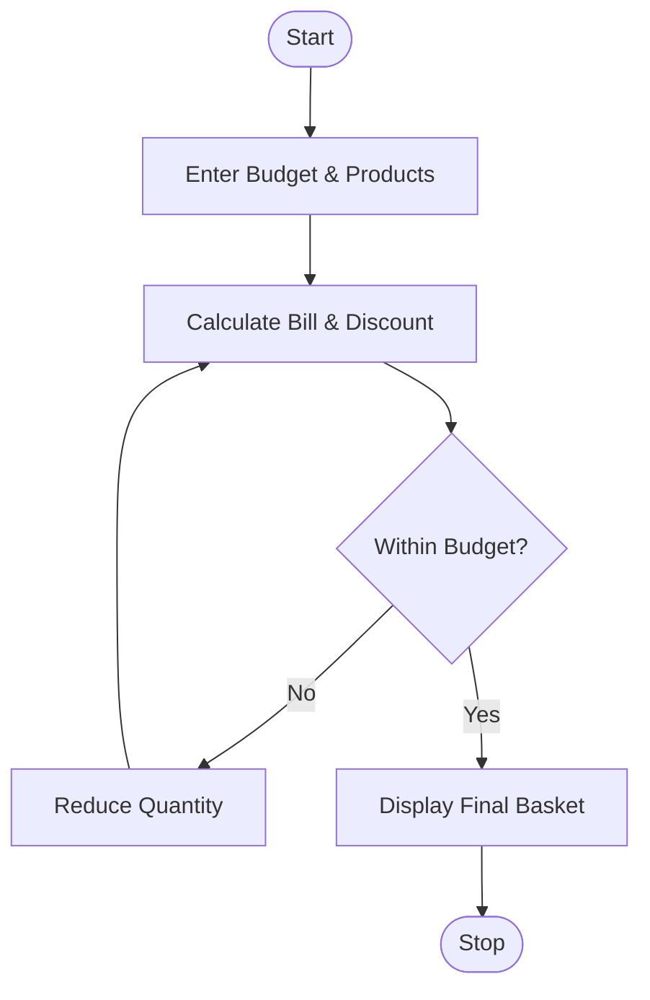

# 19. Multi-Product Shopping Budget Constraint

## 1. Problem Statement

Write a Python program to calculate the total cost of multiple products based on their prices and quantities. Apply discounts and check whether the shopping bill is within the given budget. If the bill exceeds the budget, suggest reducing product quantities.

Assumed Discount Policy:

- Total of ₹2,000 or above: 10% discount.
- Total below ₹2,000: No discount.
- If the final bill exceeds the budget, reduce the quantity of the most expensive available product first.

## 2. Algorithm

1. Start the program.
2. Enter the budget and product details.
3. Calculate the total shopping cost.
4. Apply discount if applicable.
5. Compare the final bill with the budget.
6. If the bill exceeds the budget, reduce product quantities.
7. Recalculate the bill until it fits the budget.
8. Display the final basket and stop.

## 3. Flowchart 

## 5. Sample Input

Enter budget: 1800
Number of products: 3

Product name: Rice
Price: 600
Quantity: 2

Product name: Oil
Price: 500
Quantity: 2

Product name: Sugar
Price: 100
Quantity: 2

## 6. Sample Output

Original Bill: Rs. 2160.0

Reduced 1 quantity of Rice

--- Final Shopping Basket ---
Rice - Quantity: 1
Oil - Quantity: 2
Sugar - Quantity: 2

Total: Rs. 1800.0
Discount: Rs. 0
Final Bill: Rs. 1800.0
Remaining Budget: Rs. 0.0

### Calculation

| Product | Original Quantity | Final Quantity |
| ------- | ----------------- | -------------- |
| Rice    | 2                 | 1              |
| Oil     | 2                 | 2              |
| Sugar   | 2                 | 2              |

Original Total = ₹2,400

Discount (10%) = ₹240

Original Bill = ₹2,160

After reducing one quantity of Rice:

Final Bill = ₹1,800

Therefore, the shopping basket is within the given budget.

