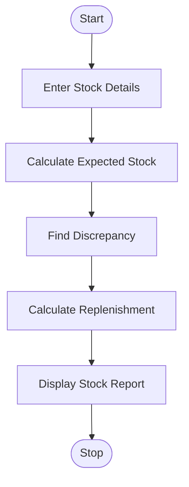

# 83. Food Supply Chain Stock Reconciliation

## 1. Problem Statement

Write a Python program to manage food stock across multiple locations. The system compares received, distributed, damaged, and remaining quantities, identifies stock discrepancies, and calculates replenishment requirements.

Conditions:

- Expected Stock = Received − Distributed − Damaged
- Discrepancy = Actual Stock − Expected Stock
- Replenishment = Maximum(0, Minimum Required Stock − Actual Stock)
- Negative quantities are not allowed.
- Minimum required stock is entered for each location.

## 2. Algorithm

1. Start the program.
2. Enter the number of locations.
3. Read received, distributed, damaged, actual stock, and minimum stock.
4. Validate the entered quantities.
5. Calculate expected remaining stock.
6. Compare expected stock with actual stock.
7. Identify stock discrepancies.
8. Calculate replenishment requirements.
9. Display the stock report for each location.
10. Stop.

## 3. Flowchart 

## 5. Sample Input

Enter number of locations: 2

Location 1
Location name: Warehouse A
Stock received: 500
Stock distributed: 300
Stock damaged: 20
Actual remaining stock: 170
Minimum required stock: 200

Location 2
Location name: Warehouse B
Stock received: 400
Stock distributed: 250
Stock damaged: 10
Actual remaining stock: 140
Minimum required stock: 180

## 6. Sample Output

--- Stock Report ---
Location: Warehouse A
Expected Stock: 180
Actual Stock: 170
Discrepancy: -10
Status: Stock Shortage
Replenishment Required: 30

--- Stock Report ---
Location: Warehouse B
Expected Stock: 140
Actual Stock: 140
Discrepancy: 0
Status: Stock Matched
Replenishment Required: 40

--- Final Summary ---
Total Replenishment: 70
Total Absolute Discrepancy: 10
Stock Reconciliation Completed

### Stock Calculation

| Details        | Warehouse A | Warehouse B |
| -------------- | ----------- | ----------- |
| Received       | 500         | 400         |
| Distributed    | 300         | 250         |
| Damaged        | 20          | 10          |
| Expected Stock | 180         | 140         |
| Actual Stock   | 170         | 140         |
| Discrepancy    | -10         | 0           |
| Replenishment  | 30          | 40          |

Explanation: Warehouse A has a shortage of 10 units, while Warehouse B has no discrepancy. Both warehouses require replenishment to maintain their minimum stock levels.

