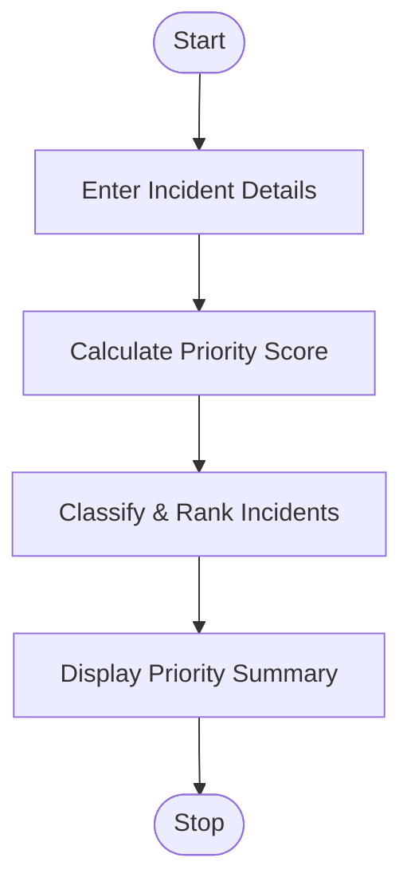

# 97. Smart Campus Incident and Maintenance Prioritization

## 1. Problem Statement

Write a Python program to classify and prioritize campus maintenance reports based on severity, location, and reported frequency. The system ranks incidents using predefined rules and generates a priority summary.

Priority Rules:

| Criteria                       | Points |
| ------------------------------ | ------ |
| High Severity                  | 3      |
| Medium Severity                | 2      |
| Low Severity                   | 1      |
| Critical Location (Lab/Hostel) | +2     |
| Other Location                 | +0     |
| Frequency ≥ 3                  | +2     |
| Frequency below 3              | +0     |

Classification:

- Score ≥ 6: High Priority
- Score 4–5: Medium Priority
- Score below 4: Low Priority

If scores are equal, higher severity, followed by higher reported frequency, gets priority. Remaining ties are resolved alphabetically by location and incident name.

## 2. Algorithm

1. Start the program.
2. Enter the number of maintenance reports.
3. Read incident name, severity, location, and frequency.
4. Calculate priority score using predefined rules.
5. Classify each incident as High, Medium, or Low.
6. Rank incidents based on score, severity, and frequency.
7. Display the priority summary.
8. Stop.

## 3. Flowchart 

## 5. Sample Input

Enter number of reports: 3

Report 1
Incident name: Water Leakage
Severity (High/Medium/Low): High
Location: Hostel
Reported frequency: 4

Report 2
Incident name: Broken Light
Severity (High/Medium/Low): Low
Location: Classroom
Reported frequency: 2

Report 3
Incident name: Computer Failure
Severity (High/Medium/Low): Medium
Location: Lab
Reported frequency: 3

## 6. Sample Output

----- PRIORITY SUMMARY -----

1 Water Leakage | Score: 7 | Priority: High
2 Computer Failure | Score: 6 | Priority: High
3 Broken Light | Score: 1 | Priority: Low

Total Reports: 3
High Priority: 2
Medium Priority: 0
Low Priority: 1

### Priority Calculation

| Incident         | Severity | Location  | Frequency | Score | Priority |
| ---------------- | -------- | --------- | --------- | ----- | -------- |
| Water Leakage    | High     | Hostel    | 4         | 7     | High     |
| Computer Failure | Medium   | Lab       | 3         | 6     | High     |
| Broken Light     | Low      | Classroom | 2         | 1     | Low      |

Explanation: Water Leakage receives the highest priority because of its high severity, critical location, and repeated reporting.

